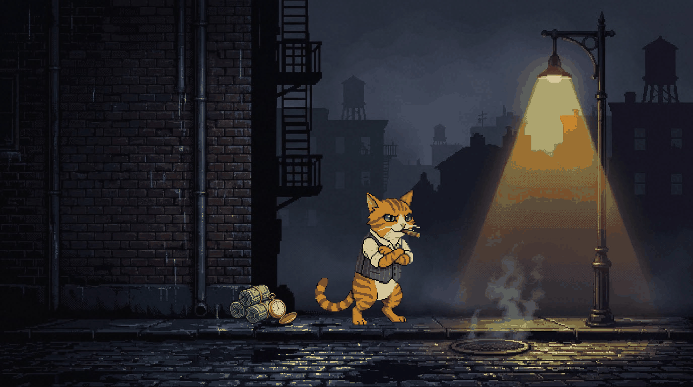
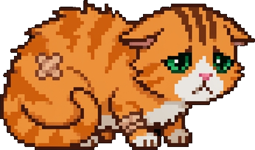
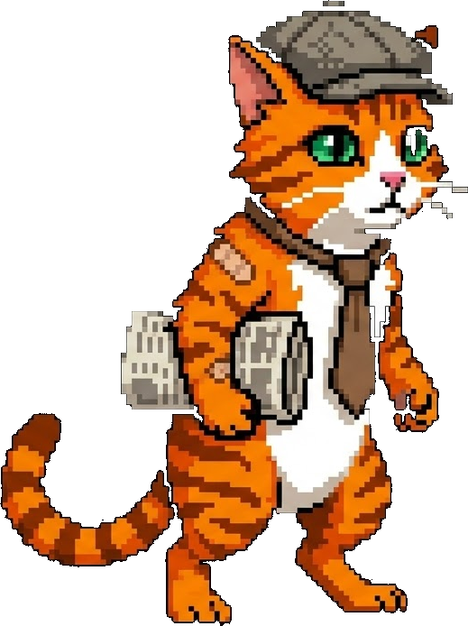
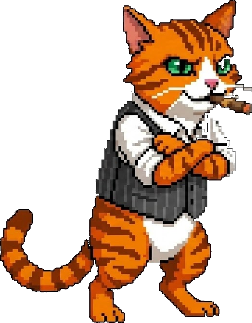
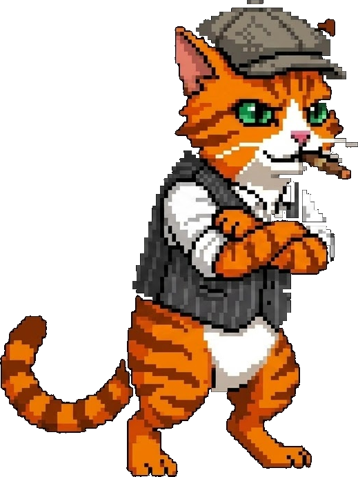
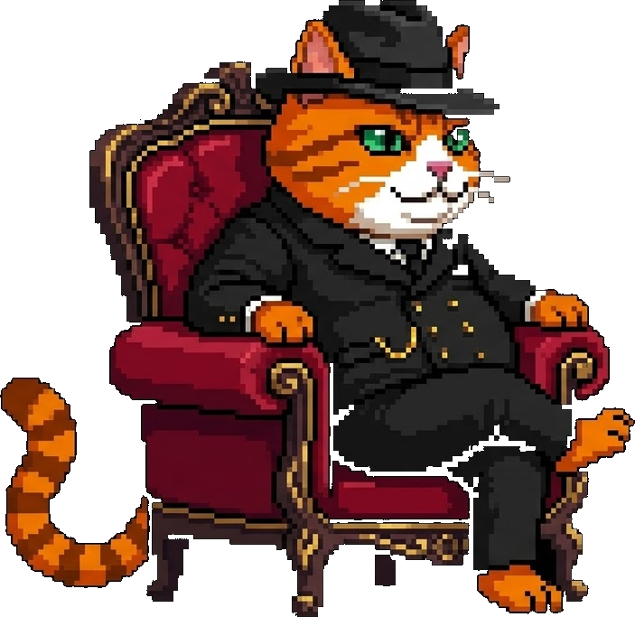
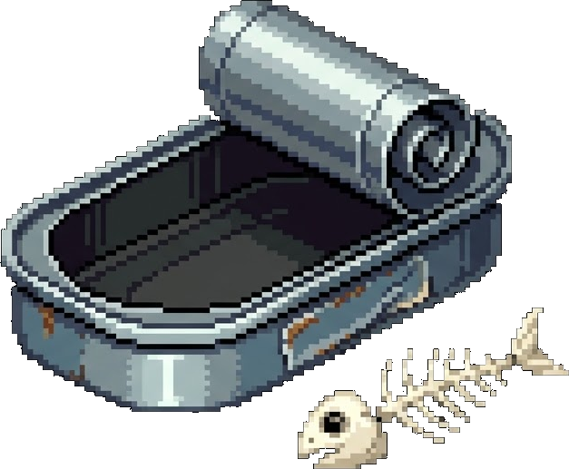
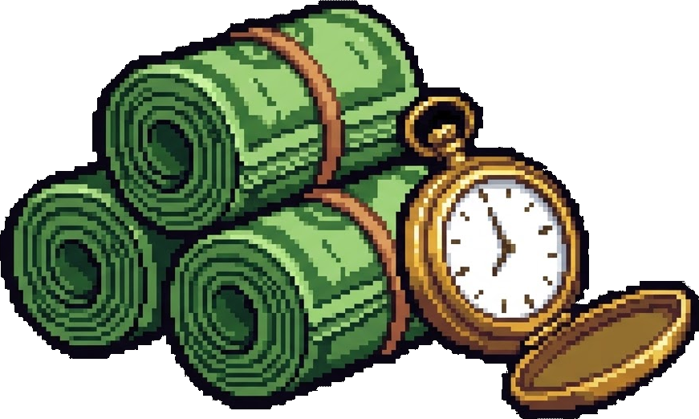
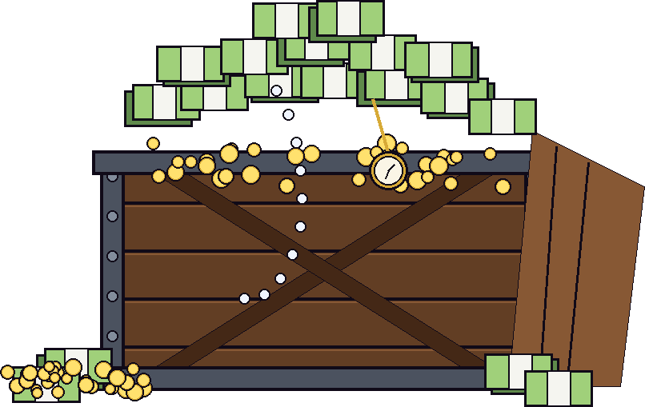
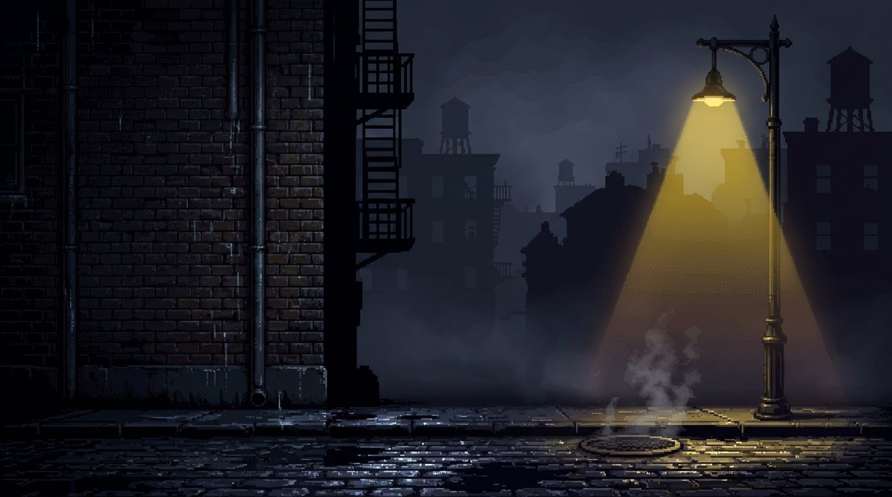

# The Clawfather: The Cat Syndicate Activity Engine

<div align="center">
  
  <p><em>Maintain the streak to sustain the Don. Break the streak and return to the gutter.</em></p>
</div>

---

## Narrative & Mechanics

**The Clawfather** is an automated, gamified activity engine that transforms your daily development habits into a living, 16-bit film-noir pixel art narrative. 

Traditional commit heatmaps display static squares. The Clawfather replaces that abstraction with an evolving theatrical stage set in a rain-slicked city alleyway of the 1940s. The scene is governed by two orthogonal axes of developer discipline:

1. **Streak Consistency (Character Rank):** Dictated by consecutive daily commit streaks. A solitary street cat rises through the underworld hierarchy—from a destitute stray huddled by the garbage to the unchallenged Clawfather in a velvet armchair.
2. **Commit Volume (Syndicate Loot):** Dictated by commits recorded within the trailing 24-hour cycle. The physical loot deposited upon the wet pavement reflects your immediate output and earnings.

---

## The Syndicate Progression

### Character Ranks (Streak Tiers)

Consecutive days of active contribution elevate the character through five narrative milestones:

| Rank | Sprite Preview | Identity | Required Streak | Narrative Condition |
|:---:|:---:|:---|:---:|:---|
| **0** |  | **The Scavenger** | `0–2 Days` | Cold repository or broken streak. A battered stray kitten shivering against the damp asphalt. |
| **1** |  | **The Street Runner** | `3–6 Days` | Early momentum. An alert newsie cat standing upright, flat cap askew, gripping the morning edition. |
| **2** |  | **The Alley Enforcer** | `7–10 Days` | Established presence. Rolled shirtsleeves, pinstripe waistcoat, casually puffing an unlit cigar. |
| **3** |  | **The Made Cat** | `11–14 Days` | Ironclad discipline. A peaked flat cap, folded arms, and an unshakeable smirk of syndicate authority. |
| **4** |  | **The Clawfather** | `15+ Days` | Absolute mastery. A plump, sovereign Don reclining comfortably in a crimson velvet armchair. |

---

### Loot Overlays (Volume Tiers)

Daily contribution volume determines the tangible earnings placed upon the sidewalk beside the character:

| Tier | Prop Preview | Wealth Classification | Daily Commits | Atmospheric Description |
|:---:|:---:|:---|:---:|:---|
| **0** |  | **The Scraps** | `0–2 Commits` | An empty, dented sardine can discarded alongside fish bones. Bare sustenance. |
| **1** |  | **The Cut** | `3–6 Commits` | Cleanly banded banknotes resting beside an antique gold pocket watch. Reliable wages. |
| **2** |  | **The Vault** | `7+ Commits` | A heavy, open wooden syndicate crate overflowing with cash stacks, bullion, and jewels. Exceptional wealth. |

---

## Architectural & Pixel Engine Specifications

<div align="center">
  
  <p><em>Master Canvas: 1376 x 768 px Film Noir City Alleyway</em></p>
</div>

### 1. Ground-Plane Baseline Anchoring
To prevent sprites from hovering over the pavement or clipping through the street, all actors and props are keyed to a common vertical horizon:
- **Sidewalk Baseline**: Fixed at exactly $Y = 84\%$ of total canvas height ($645\text{ px}$).
- **Calculated Y-Position**: $Y_{\text{anchor}} = 645 - \text{Height}_{\text{sprite}}$.
- **Horizontal Staging**: The cat character is centered beneath the alley streetlamp ($X \approx 53\%$), while the loot prop is staged to the character's left with a proportional safety margin.

### 2. Relative Proportions
- **The Stray Kitten**: Locked to $18\%$ canvas height ($234 \times 138\text{ px}$) to emphasize vulnerability.
- **Upright Enforcers**: Scaled to $35\%$ canvas height ($200 \times 268\text{ px}$) to reflect street presence.
- **The Armchair Don**: Scaled to $44\%$ canvas height ($346 \times 337\text{ px}$) to project dominant stature.
- **Floor Props**: Scaled between $8\%$ and $13\%$ canvas width, ensuring loot remains subordinate to characters.

### 3. Atmospheric Micro-Animation
The output engine compiles an eight-frame, native animated GIF operating at $220\text{ ms}$ per frame:
- **Idle Breathing Cycle**: Sub-pixel vertical translation (`[0, -1, -2, -1, 0, 1, 2, 1] px`) applied exclusively to the cat sprite. Props remain rigidly grounded on the cobblestones.
- **Streetlamp Voltage Fluctuations**: Procedural brightness modulation (`0.94x` to `1.04x`) simulating intermittent current drops in the alley lantern.
- **Vintage Projection Grain**: Procedural film-noir grain overlay imparting a textured cinematic aesthetic without palette distortion.

---

## Deployment & Automation

### Step 1: Grant Workflow Write Permissions
1. Navigate to your repository: **Settings** &rarr; **Actions** &rarr; **General**.
2. Locate the **Workflow permissions** subsection.
3. Select **Read and write permissions**.
4. Enable the checkbox for **Allow GitHub Actions to create and approve pull requests**.
5. Save your changes.

### Step 2: Embed into Your GitHub Profile
Add the following HTML snippet to your personal profile `README.md` (`rajtharun08/rajtharun08`):

```html
<div align="center">
  <h3>The Syndicate Status</h3>
  <a href="https://github.com/rajtharun08/Clawfather">
    
  </a>
  <p><em>Maintain the streak to sustain the Don. Break the streak and return to the gutter.</em></p>
</div>
```

### Step 3: Scheduled Autonomous Execution
The automated workflow [`.github/workflows/update_syndicate.yml`](.github/workflows/update_syndicate.yml) runs every six hours via GitHub Actions (`cron: '0 */6 * * *'`). It securely queries the GitHub GraphQL API using the default repository token, renders the updated frame sequence, and commits the resulting [`output/profile_tracker.gif`](output/profile_tracker.gif) with `[skip ci]`.

---

## Local Testing & Simulation

The compositor can be executed locally to simulate varying streaks and commit volumes:

```bash
# Install core dependencies
pip install -r requirements.txt

# Render using automatic GitHub contribution metrics
python src/compositor.py

# Simulate Rank 0: Stray Kitten with empty sardine tin
python src/compositor.py --streak 0 --commits 0

# Simulate Rank 1: Street Runner with modest cash
python src/compositor.py --streak 4 --commits 4

# Simulate Rank 4: The Clawfather with syndicate crate vault
python src/compositor.py --streak 20 --commits 10
```

---

## Repository Tree

```text
the-clawfather/
├── .github/
│   └── workflows/
│       └── update_syndicate.yml   # Scheduled 6-hour cron and manual dispatch
├── assets/
│   ├── background.png             # Master 1376x768 film-noir stage canvas
│   ├── cat_tier_0.png             # Shivering stray cat sprite
│   ├── cat_tier_1.png             # Newsie cat sprite
│   ├── cat_tier_2.png             # Pinstripe enforcer sprite
│   ├── cat_tier_3.png             # Made enforcer sprite with cap
│   ├── cat_tier_4.png             # Velvet armchair Don sprite
│   ├── prop_tier_0.png            # Sardine tin with fish bones
│   ├── prop_tier_1.png            # Cash bundles and pocket watch
│   └── prop_tier_2.png            # Open syndicate treasure crate
├── output/
│   └── profile_tracker.gif        # Compiled animated GIF for profile embedding
├── src/
│   ├── compositor.py              # Baseline layout engine and animator
│   └── github_client.py           # GraphQL activity parser and fallback handler
├── requirements.txt               # Runtime dependencies (Pillow, requests)
└── README.md                      # Project manual and visual documentation
```

---

<div align="center">
  <sub>Crafted for deliberate developers and pixel-art connoisseurs. Keep coding.</sub>
</div>
